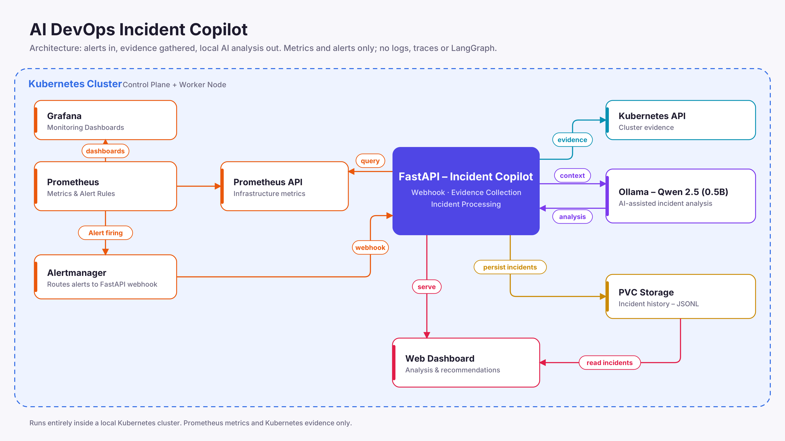
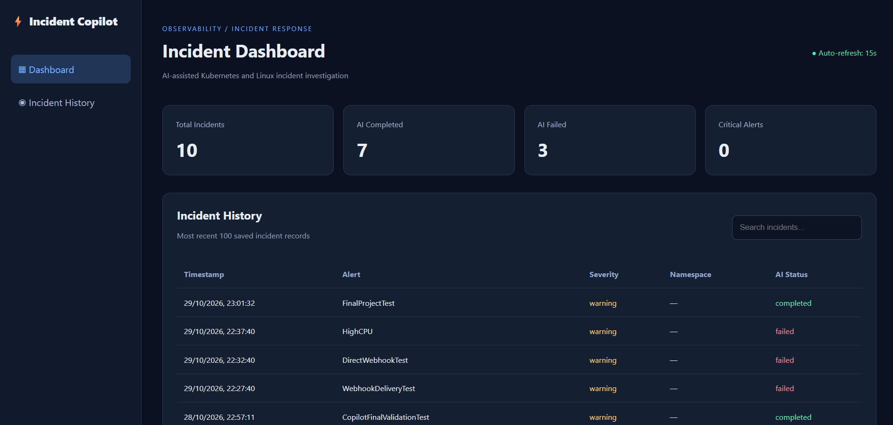
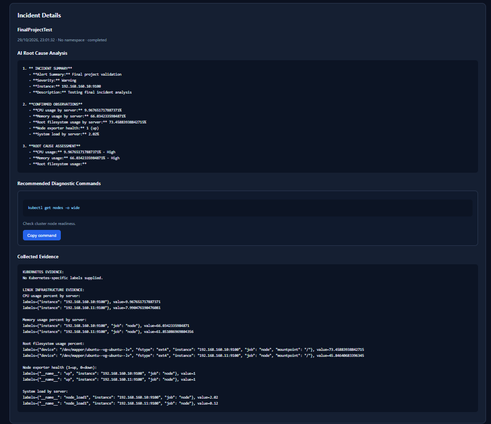
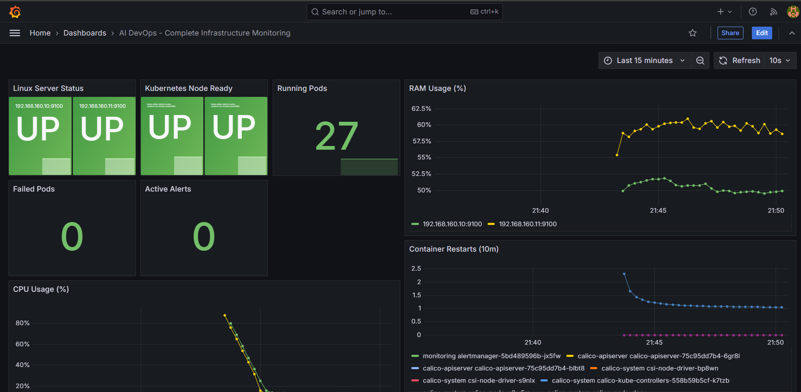
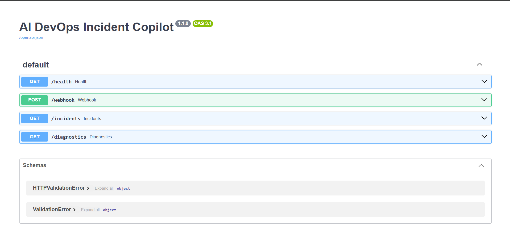
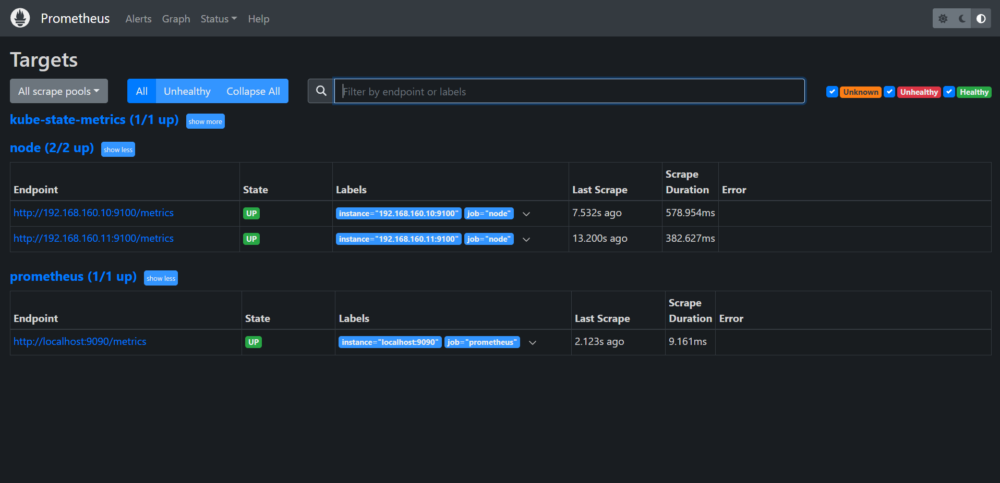

# AI DevOps Incident Copilot

An AI-assisted DevOps incident investigation application deployed on a Kubernetes cluster.

The application receives Prometheus alerts through Alertmanager, collects available Linux and Kubernetes metrics, uses a locally hosted Ollama model to generate an initial incident analysis, and stores incident records for review through a web dashboard.

> **Project scope:** This implementation focuses on alert context, infrastructure metrics, and AI-assisted incident triage. It is not an autonomous remediation system. Log analysis using Loki, distributed tracing, and LangGraph orchestration are not implemented.

## Overview

The project helps organize the initial stage of DevOps incident investigation.

When an infrastructure alert fires, engineers often need to inspect monitoring tools, collect metrics, investigate the issue, and prepare an incident summary. This project brings these initial investigation steps into one workflow.

### Features

- Receive firing alerts through an Alertmanager webhook.
- Collect Linux CPU, memory, filesystem, node exporter, and system load metrics from Prometheus.
- Query Kubernetes metrics when supported object labels are available.
- Generate incident summaries and probable root-cause assessments using a local Ollama model.
- Perform limited evidence-consistency checks on AI-generated analysis.
- Store incident history using a Kubernetes PersistentVolumeClaim.
- Display incident history, evidence, AI analysis, and processing status in a web dashboard.
- Build and publish Docker images using GitHub Actions.

## Architecture



Linux Nodes + Kubernetes Metrics
              |
              v
          Prometheus
       (Metrics + Alerts)
              |
              v
         Alertmanager
              |
         HTTP Webhook
              |
              v
       FastAPI Incident Copilot
              |
       Evidence Collection
              |
       +------+------+
       |             |
       v             v
  Prometheus API   Ollama LLM
  Metrics Data     Qwen 2.5 0.5B
       |             |
       +------+------+
              |
              v
     AI Incident Analysis
              |
       +------+------+
       |             |
       v             v
  Kubernetes PVC  Web Dashboard
  Incident History Incident Review

Grafana: Monitoring Dashboard

## Project Screenshots

### 1. Incident Copilot Dashboard



### 2. AI Incident Analysis



### 3. Grafana Monitoring Dashboard



### 4. Swagger API Documentation



### 5. Prometheus Monitoring Targets



## Incident Processing Workflow

1. Prometheus collects infrastructure metrics and evaluates alert rules.
2. Alertmanager forwards firing alerts to the Copilot webhook.
3. FastAPI accepts the alert and queues background processing.
4. The application collects available Linux and Kubernetes evidence from Prometheus.
5. Alert details and collected evidence are sent to Ollama.
6. Ollama generates an initial incident analysis.
7. A limited evidence validator checks for potentially unsupported claims.
8. The incident, evidence, AI analysis, and processing status are saved to persistent storage.
9. Engineers review the incident through the dashboard.

**Note:** A webhook response of `accepted` means the alert was queued. It does not mean AI analysis has completed.

## Technology Stack

| Technology | Purpose |
|---|---|
| Python | Application logic |
| FastAPI | Webhook and REST API |
| Docker | Containerization |
| Kubernetes | Application deployment |
| Prometheus | Metrics collection and alert evaluation |
| node_exporter | Linux host metrics |
| kube-state-metrics | Kubernetes object metrics |
| Alertmanager | Alert routing |
| Ollama | Local LLM runtime |
| Qwen 2.5 0.5B | AI model |
| PersistentVolumeClaim | Incident persistence |
| GitHub Actions | CI image build |
| Docker Hub | Container image registry |

## Repository Structure

```text
ai-devops-incident-copilot/
│
├── .github/
│   └── workflows/
│       └── build.yml
│
├── app/
│   ├── main.py
│   ├── evidence_validator.py
│   ├── diagnostics.py
│   └── static/
│
├── deploy/
│   └── base/
│
├── docs/
│   └── images/
│       ├── ai-devops-incident-copilot-architecture-uploaded.png
│       ├── incident-dashboard.png
│       ├── incident-analysis.png
│       ├── grafana-dashboard.png
│       ├── swagger-api.png
│       └── prometheus-targets.png
│
├── monitoring/
│   ├── alertmanager.yml
│   └── prometheus-rules.yml
│
├── tests/
│
├── .dockerignore
├── .gitignore
├── Dockerfile
├── README.md
└── requirements.txt
```

## Lab Environment

Developed and tested in a local VMware Kubernetes environment.

| Component | Configuration |
|---|---|
| Control Plane | 192.168.160.10 |
| Worker Node | 192.168.160.11 |
| Kubernetes | v1.30.14 |
| Namespace | incident-copilot |
| Application NodePort | 30800 |
| Application Port | 8000 |
| Prometheus | prometheus.monitoring.svc.cluster.local:9090 |
| Ollama | http://192.168.160.10:11434 |
| Model | qwen2.5:0.5b |

These are private lab addresses. Update them for your own environment.

## Prerequisites

- Kubernetes cluster and kubectl
- Docker
- Prometheus
- node_exporter
- kube-state-metrics
- Alertmanager
- Ollama with the configured model
- PersistentVolume provisioner and PVC

## Configuration

The application supports the following environment variables:

| Variable | Default | Description |
|---|---|---|
| PROM_URL | http://127.0.0.1:9090 | Prometheus API |
| OLLAMA_URL | http://127.0.0.1:11434 | Ollama API |
| MODEL | qwen2.5:0.5b | AI model |
| INCIDENT_FILE | /data/incidents.jsonl | Incident storage file |

### Prepare Ollama

```bash
ollama pull qwen2.5:0.5b
ollama list
```

Ensure the Ollama API is reachable from the Kubernetes application Pod.

## Kubernetes Deployment

Review the manifests and update lab-specific addresses, image names, storage settings, and webhook destinations before deployment.

```bash
kubectl apply -k deploy/base
```

Verify the deployment:

```bash
kubectl get all -n incident-copilot
kubectl get pvc -n incident-copilot
kubectl rollout status deployment/incident-copilot -n incident-copilot
kubectl logs deployment/incident-copilot -n incident-copilot
```

### Application URLs

```text
Dashboard:
http://<KUBERNETES-NODE-IP>:30800/dashboard

Health:
http://<KUBERNETES-NODE-IP>:30800/health

API Documentation:
http://<KUBERNETES-NODE-IP>:30800/docs
```

## API Endpoints

| Method | Endpoint | Description |
|---|---|---|
| GET | /health | Application health |
| POST | /webhook | Receive alerts |
| GET | /incidents?n=10 | Retrieve incidents |
| GET | /diagnostics?n=10 | Retrieve diagnostic suggestions |
| GET | /dashboard | Incident dashboard |
| GET | /docs | API documentation |

### Health Check

```bash
curl http://<NODE-IP>:30800/health
```

### Test Webhook

```bash
curl -sS --max-time 15 \
  -X POST http://<NODE-IP>:30800/webhook \
  -H 'Content-Type: application/json' \
  -d '{
    "receiver": "incident-copilot",
    "status": "firing",
    "alerts": [
      {
        "status": "firing",
        "labels": {
          "alertname": "CopilotManualTest",
          "severity": "warning",
          "instance": "192.168.160.10:9100"
        },
        "annotations": {
          "summary": "Manual incident investigation test",
          "description": "Testing the incident workflow"
        }
      }
    ]
  }'
```

Expected immediate response:

```json
{
  "status": "accepted",
  "alerts_queued": 1
}
```

Check the incident after background processing:

```bash
curl -sS 'http://<NODE-IP>:30800/incidents?n=10'
```

## GitHub Actions CI

The GitHub Actions workflow:

- Runs on pushes and pull requests targeting `main`.
- Builds the Docker image using Docker Buildx.
- Publishes the image to Docker Hub on pushes to `main`.
- Uses a commit-SHA tag and a `latest` tag.
- Builds without publishing on pull requests.

Configure these GitHub repository secrets:

```text
DOCKERHUB_USERNAME
DOCKERHUB_TOKEN
```

Configured image:

```text
myserverd/ai-devops-incident-copilot
```

## Persistent Storage

Incident records are stored in:

```text
/data/incidents.jsonl
```

The application mounts a Kubernetes PVC at `/data`, allowing incident history to survive application Pod replacement, subject to the PersistentVolume lifecycle.

## Evidence Validation

The application collects configured Prometheus metrics and conditionally queries Kubernetes metrics using supported alert labels.

The evidence validator performs limited text-pattern checks for potentially unsupported AI statements.

It is not a complete fact-checking system. AI-generated analysis must be reviewed against the original alert, metrics, Kubernetes events, and application logs.

## Troubleshooting

### AI Analysis Timeout

- Verify Ollama is running.
- Check OLLAMA_URL connectivity from the application Pod.
- Confirm the model exists using `ollama list`.
- Check CPU and memory availability.
- Review application logs.

### Missing Prometheus Evidence

- Verify PROM_URL.
- Check Prometheus targets.
- Confirm node_exporter is running.
- Confirm kube-state-metrics is available.
- Verify alert labels contain supported Kubernetes object names.

### Incident Not Persisting

- Check PVC status.
- Verify the volume is mounted at `/data`.
- Check file permissions.
- Review application logs.

## Current Limitations

- This is an AI-assisted triage tool, not an autonomous SRE agent.
- It currently analyzes alert context and Prometheus metrics.
- Loki-based log analysis is not implemented.
- Distributed tracing is not implemented.
- LangGraph orchestration is not implemented.
- Automatic remediation is not implemented.
- AI analysis can be incomplete, inaccurate, or time out.
- Human verification is required before taking remediation actions.
- Resolved alerts are currently skipped by the webhook handler.

## Future Improvements

Possible future enhancements:

- Centralized log collection and investigation.
- Distributed tracing integration.
- Improved evidence correlation.
- Stronger structured validation.
- Complete alert lifecycle handling.
- Dashboard authentication and access control.
- Expanded automated testing.

## Project Objective

Demonstrate how monitoring, alert routing, infrastructure evidence collection, local LLM analysis, Kubernetes deployment, persistent incident history, and CI automation can work together to support initial DevOps incident investigation.

**AI + Observability + Kubernetes**
